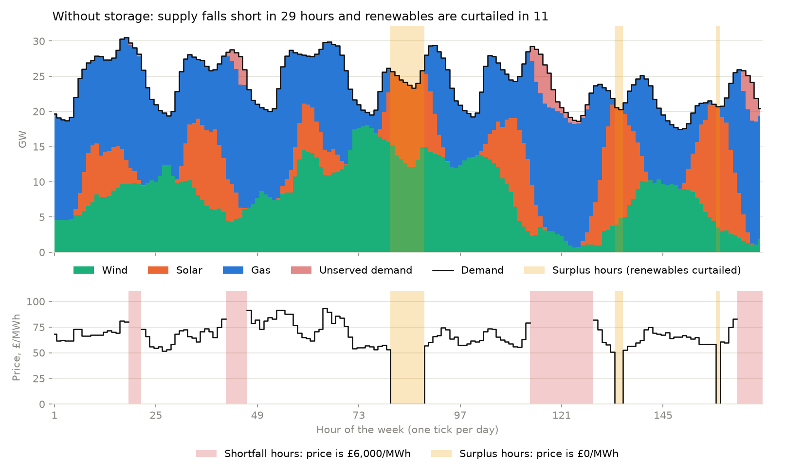
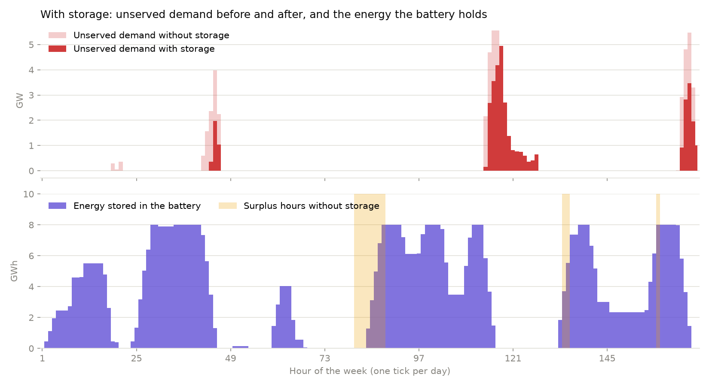
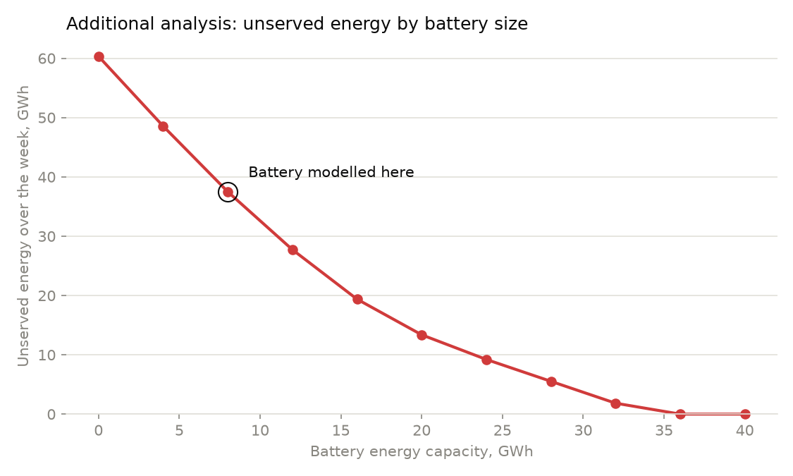

# Hourly power auction with storage

A pay-as-clear electricity auction for one week (168 hours) of wind, solar and gas, and the same
auction with a battery added.

## Findings

- **Without storage, the market fails in two directions.** In 29 hours all available supply
  cannot meet demand (60.3 GWh unserved). In 11 hours wind and solar exceed demand, the price is
  £0 and 36.0 GWh is curtailed. Gas sets the price in the other 128 hours, at £51–94/MWh.
- **A 2 GW / 8 GWh battery, scheduled for lowest system cost, removes 38% of the unserved
  energy** (60.3 → 37.5 GWh) and cuts system cost from £471m to £335m. It clears the smallest of
  the four shortfalls and reduces the other three.
- **It lifts 3 of the 11 zero-price hours to £51–58/MWh** by charging in them, and cuts
  curtailment by 10.0 GWh.
- **The relief is partial because the shortfalls are large.** With four hours of storage,
  removing every shortfall takes a battery of between 8 and 9 GW (32–36 GWh).

## Run it

```
python -m venv .venv
.venv\Scripts\activate          # macOS/Linux: source .venv/bin/activate
pip install -r requirements.txt
python -m power_auction         # a few seconds; writes the tables and charts in outputs/
pytest                          # 21 tests
```

Tested with Python 3.14 and pandas 2.3 and 3.1. The results are already in `outputs/`: hourly
price and mix in `part1_hourly.csv` (Part 1) and `part2_hourly.csv` (Part 2, with the battery's
charge, discharge and stored energy), and week totals in `summary.csv`.

## Part 1: the auction

Implemented as the brief states. Wind and solar offer capacity × load factor at £0. Each gas
plant offers its full capacity at `(gas price in pence / 100 × 34.121) / efficiency` £/MWh. Bids
are accepted cheapest first until demand is met, and the last accepted bid is the price paid to
everyone. All gas plants pay the same gas price, so the merit order is the same every hour:
`gas5` (55% efficient) is cheapest and `gas1` (35%) is dearest.

Over the week the mix is 35.6% wind, 19.7% solar, 44.7% gas.



The brief is silent on three cases. Each needed a decision:

| Case | Decision | Reason |
|---|---|---|
| Supply cannot meet demand (29 hours) | Price is £6,000/MWh and unserved energy is reported | The brief's price rule has no answer here. £6,000 is the Value of Lost Load used in GB imbalance pricing since 2018. It is an administrative figure from balancing, not a day-ahead rule, and it is an assumption. |
| Renewables exceed demand (11 hours) | Price is £0; wind and solar are cut back by the same share | They tie at £0, so there is no basis for preferring one. |
| Demand is met exactly when a plant is full | That plant sets the price, not the next one | The brief's wording: "the lowest bid for which dispatching all generators with a lower or equal bid fills up the demand". |

The £6,000 figure matters a great deal for money totals: shortfall hours are 95% of what
consumers pay in the week without storage. It does not matter for dispatch.

## Part 2: storage

### How the battery takes part

The battery is **scheduled centrally to give the lowest total system cost over the week**, where
system cost is gas fuel plus £6,000 for every MWh of demand not served. It does not submit bids.
Its charging is added to demand and its discharging is taken off demand, and then the Part 1
auction function is run unchanged on that net demand. So one price rule covers both parts, and
the battery never sets the price, including in the five hours (20, 21, 42, 43, 163) where it is
the last supplier needed and `gas1` sets the price.

The schedule comes from a linear program over all 168 hours (`scipy.optimize.linprog`). Prices
are not taken from the solver's shadow prices: those are a second price rule next to the
brief's, and they are not unique when the battery lands demand exactly on the edge between two
plants. With no battery the solver's cost and shadow prices equal the auction's in all 168
hours, which is tested.

**Why not maximise the battery's profit?** A 2 GW battery moves prices. One that maximises its
own profit knowing this would hold energy back to keep prices high. Without storage, hour 120 is
short by 1,372 MW: discharging 1,371 MW keeps the price at £6,000, discharging 1,372 MW drops it
to a gas bid. A battery that maximises profit while assuming prices do not move has the opposite
fault: it ignores the main effect of its own size. Minimising system cost is the outcome of a
competitive market in which the battery cannot steer prices. Battery profit is reported below
as a result at the resulting prices, not as what a profit-seeking battery would choose.

### Assumptions

| Assumption | Value | Note |
|---|---|---|
| Power and energy | 2,000 MW, 8,000 MWh | Illustrative, not a real asset. About 7% of peak demand, four hours at full power. |
| Round-trip efficiency | 85% | Split evenly: about 92% on charging and 92% on discharging. A full battery delivers about 7,376 MWh. |
| Stored energy at start and end | Empty | End equals start, so the battery cannot use energy from outside the week. |
| Foresight | Perfect, whole week | The brief gives demand and load factors in advance. A real battery forecasts, so these results are an upper bound on what it could achieve. |
| Tie-break | Earliest shortfall first | See below. |

### The tie-break, and what depends on it

Every MWh that relieves a shortfall saves the same £6,000 whichever shortfall hour it goes to,
so many schedules share the lowest cost. They differ in which hours stay in shortfall, and so in
prices. A second solve picks one of them: with cost held at the lowest, it stores the least
energy for the shortest time. In effect the battery discharges as soon as a shortfall starts and
charges as late as it can. The rule was chosen because it is simple and does not look at prices:
the battery serves demand when it is short instead of saving energy for a later hour.

Unserved energy and system cost are the same for every lowest-cost schedule. **The number of
shortfall hours, the consumer bill and battery profit are not, and the difference is large.**
A rule that relieves the smallest shortfalls first, at exactly the same system cost, leaves 13
shortfall hours instead of 23, a consumer bill of £2.06bn instead of £3.26bn and battery profit
of £79m instead of £119m. (That rule is not in this repo; the figures come from replacing the
second solve's objective.) Hour 128 shows why: the battery leaves 4.4 MW unserved there, the
hour is still priced at £6,000, and that alone is £136m of the consumer bill.

### Results



| Week total | Without storage | With storage |
|---|---|---|
| Unserved energy | 60,326 MWh | 37,494 MWh |
| Renewables curtailed | 35,969 MWh | 25,970 MWh |
| Gas generation | 1,783 GWh | 1,803 GWh |
| Gas fuel cost | £109.3m | £110.1m |
| **System cost** (fuel + £6,000 × unserved) | **£471.3m** | **£335.1m** |
| Hours at £0 | 11 | 8 |
| Shortfall hours * | 29 | 23 |
| Consumer bill (price × demand served) * | £4,125m | £3,256m |
| Battery profit * | – | £119m |

\* Depends on the tie-break rule and on the £6,000 shortfall price.

What the battery does:

- **It takes in 49.7 GWh and delivers 42.3 GWh**, about 5.7 full cycles in the week.
- **About 80% of its charging comes from gas**, not from spare renewables. Surplus hours are
  few, so it mostly charges in ordinary hours from gas plants with spare capacity and
  discharges into shortfalls. This is why gas generation rises by 1.1%.
- **It cannot cover the long shortfall.** Hours 114–128 are short by 31.3 GWh with no surplus
  in between. The battery removes 7.4 GWh of that, one full discharge.
- **All of its profit comes from shortfall hours.** It earns £119.6m in the 11 hours where it
  discharges at £6,000 and loses £0.7m over the rest of the week.

Re-running with a shortfall price anywhere from £100 to £20,000 gives the same shortfall hours,
the same price-setting plant in every hour and the same schedule to within 2 MW.

## Additional analysis

These go beyond the brief and do not change any Part 1 or Part 2 output.

**Battery size.** The same model for batteries from 0 to 10 GW, each with four hours of
storage. Only unserved energy and system cost are shown, because they do not depend on the
tie-break.



**Why this matters for Contracts for Difference.** A CfD generator is topped up by the strike
price minus the market reference price, so the top-up per MWh is largest when the market price
is lowest. Hours at £0 are the most expensive ones for the scheme, and they are the hours when
wind and solar produce most. Storage that charges in those hours raises the price: here in
hours 134, 135 and 158, from £0 to £51–58/MWh. The other eight stay at £0 because the surplus
(up to 7.1 GW, eight hours in a row) is far more than a 2 GW / 8 GWh battery can absorb. No CfD
payments are modelled.

## Other rejected alternatives

| Alternative | Why not |
|---|---|
| Battery minimises the consumer bill | No participant is paid to do this, and it steers prices as much as the profit-maximiser does, in the other direction. |
| A greedy rule (charge when cheap, discharge when dear) | Simpler, but it cannot know to hold energy back for a later, larger shortfall, so it does not reach the lowest cost. |
| Imports, demand response, other technologies | Not in the brief. |

## Checks

- Part 1 reproduces three hours worked out by hand, a toy market covering every case, and the
  week totals.
- The solver with no battery and the merit-order auction are independent methods; they agree on
  cost and price in all 168 hours.
- With the battery: energy balances every hour, the battery stays within its limits and ends
  empty, and the auction on net demand costs exactly what the solver found.

The price function treats a plant producing less than 1 kW as not running. The solver places
demand exactly on plant boundaries, and without this tolerance rounding noise would pick the
price. Part 1 results are identical with and without it.
